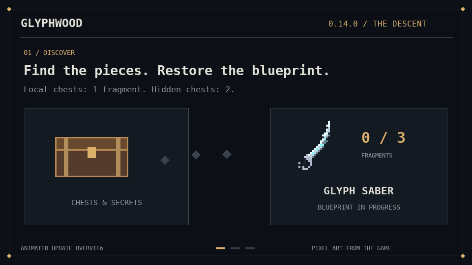
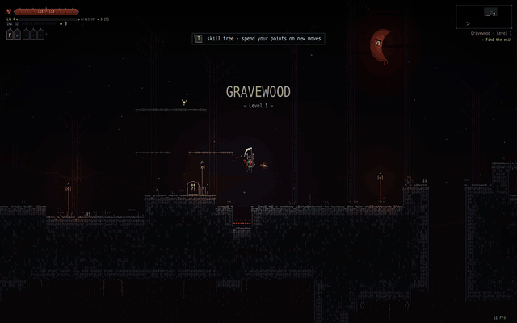

<h1 align="center">Glyphwood</h1>

<p align="center">A gothic pixel action platformer: an endless descent.</p>

<p align="center">
  
</p>

<p align="center">0.14.0 · Fragments &amp; Expeditions</p>

<p align="center">
  Find blueprint fragments, unlock each biome’s collection, then choose your next expedition.
</p>

<p align="center">
  <a href="https://github.com/drugdamage/glyphwood/releases/latest">Download</a> ·
  <a href="CHANGELOG.md">Changelog</a> ·
  <a href="CONTRIBUTING.md">Contributing</a>
</p>

- Collect three fragments to unlock special gear; choose a blueprint to focus your search.
- Find distinct stock in all six biomes, plus four new armour options.
- Beyond the first 18 levels, choose shorter expeditions with mixed foes and different rewards.

Existing worlds keep their gear, reforges and depth. See the [update notes](CHANGELOG.md)
and [next steps](docs/ROADMAP.md).

<details>
<summary>Gameplay recording (0.13.0)</summary>



</details>

The animation above illustrates the update using game sprites; it is not a new gameplay recording.

## Install

macOS / Linux:

```sh
curl -fsSL https://raw.githubusercontent.com/drugdamage/glyphwood/main/install.sh | sh
```

Windows (PowerShell):

```powershell
irm https://raw.githubusercontent.com/drugdamage/glyphwood/main/install.ps1 | iex
```

Run it again to update.

## Run from source

Open `project.godot` in [Godot 4.5+](https://godotengine.org/download) and press **F5**.

## License

[MIT](LICENSE)
