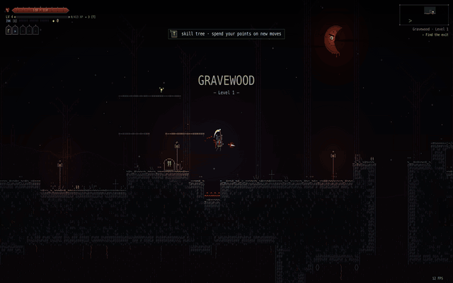
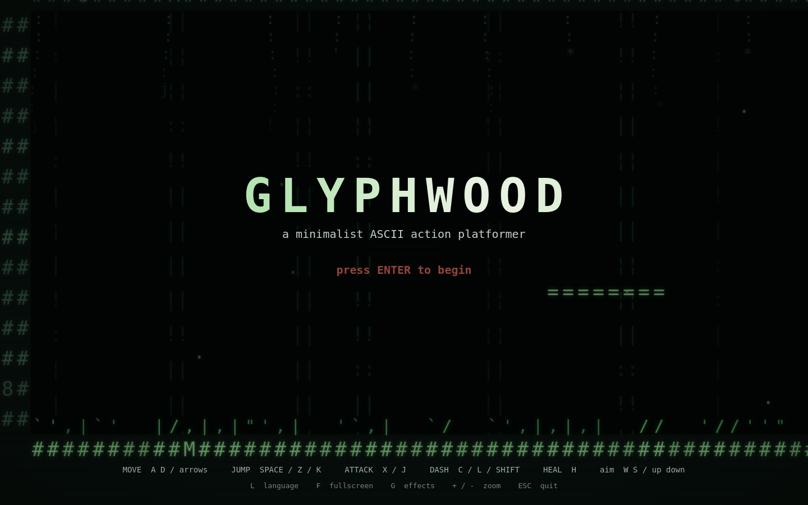

<div align="center">

# GLYPHWOOD

**A minimalist ASCII action platformer with roguelite runs.**<br>
Everything on screen, from the hero to the grass, is drawn with text glyphs.

[](https://godotengine.org)
[](LICENSE)
[](https://github.com/drugdamage/glyphwood/releases/latest)
[](https://github.com/drugdamage/glyphwood/actions/workflows/ci.yml)
[](https://drugdamage.github.io/glyphwood/)

[**▶ Play in browser**](https://drugdamage.github.io/glyphwood/) ·
[**Download**](https://github.com/drugdamage/glyphwood/releases/latest) ·
[Changelog](CHANGELOG.md) ·
[Contributing](CONTRIBUTING.md) ·
[Русская версия](#русский)



</div>

## About

Glyphwood is a fast, keyboard-only action platformer in the spirit of tight
precision platformers, rendered entirely with monospace characters. Each run
stitches hand-made rooms into a new level; dive as deep as you can through three
biomes before your five hearts run out. Death is permanent.

Made with [Godot 4](https://godotengine.org) and GDScript. Free and open source
under the MIT license.

## Features

- Responsive movement: variable jump, coyote time, jump buffering, dash with invulnerability, wall slide and wall jump, drop through platforms
- Combat: three-hit combo, up and down slashes, pogo off enemies and spikes, hit-stop and screen shake
- Four enemy types: crawler, bat, knight (telegraphed lunge), spitter (projectiles you can slash)
- Levels assembled from hand-made chunks, so every run is different; three biomes that cycle with difficulty
- Healing flasks, hearts, collectible shards, permadeath
- English and Russian interface

## Play

### In the browser

**[drugdamage.github.io/glyphwood](https://drugdamage.github.io/glyphwood/)** —
works in current desktop Chrome, Edge and Firefox (a keyboard is required).
Click the game once so it receives keyboard input.

### Download

Grab the build for your system from the
**[latest release](https://github.com/drugdamage/glyphwood/releases/latest)**:

| Platform | File | Notes |
| --- | --- | --- |
| Windows | `glyphwood-<version>-windows.zip` | Unzip and run `Glyphwood.exe`. SmartScreen may warn about an unknown publisher: **More info → Run anyway**. |
| Linux | `glyphwood-<version>-linux.zip` | Unzip and run `./glyphwood.x86_64` (x86_64). |
| macOS | `glyphwood-<version>-macos.zip` | Universal (Apple Silicon and Intel). The app is not notarized: right-click → **Open**, or allow it in **System Settings → Privacy & Security → Open Anyway**. |
| Web | `glyphwood-<version>-web.zip` | Self-host the browser build on any static web server. |

### From source

1. Install [Godot 4.5 or newer](https://godotengine.org/download) (the standard build, not .NET).
2. Clone this repository: `git clone https://github.com/drugdamage/glyphwood.git`
3. In the Project Manager choose **Import** and select `project.godot` from this folder.
4. Press **F5** (or the ▶ button) to play.

## Controls

| Key | Action |
| --- | --- |
| `A` `D` / `←` `→` | Move |
| `Space` / `Z` / `K` | Jump (hold for higher), also wall jump |
| `X` / `J` | Attack |
| `W` / `↑` + attack | Up slash |
| `S` / `↓` + attack in the air | Down slash (bounces off enemies and spikes) |
| `S` + jump | Drop through a platform |
| `C` / `L` / `Shift` | Dash |
| `H` | Drink a healing flask |
| `Esc` / `P` | Pause |
| `+` / `-` | Zoom |
| `F` | Fullscreen |
| `G` | Glow effects on/off |
| `L` (title, pause) | Switch language |

## Building and exporting

Export presets for **Windows Desktop**, **Linux**, **macOS** (universal, ad-hoc
signed) and **Web** (no thread support, so it runs on GitHub Pages without
special headers) are in [`export_presets.cfg`](export_presets.cfg).

1. Install the Godot 4.5.1 export templates (**Editor → Manage Export Templates**).
2. Export from the editor (**Project → Export**) or from the command line:

```sh
godot --headless --path . --import
godot --headless --path . --export-release "Windows Desktop" build/windows/Glyphwood.exe
godot --headless --path . --export-release "Linux"           build/linux/glyphwood.x86_64
godot --headless --path . --export-release "macOS"           build/macos/Glyphwood.zip
godot --headless --path . --export-release "Web"             build/web/index.html
```

To test the Web build locally, serve the folder over HTTP, e.g.
`python3 -m http.server -d build/web 8000`.

### Continuous integration

| Workflow | Trigger | What it does |
| --- | --- | --- |
| [`ci.yml`](.github/workflows/ci.yml) | push, pull request | `gdlint`, headless import with Godot 4.5.1 (fails on script errors), bot smoke test |
| [`pages.yml`](.github/workflows/pages.yml) | push to `main`, tags | exports the Web build and deploys it to GitHub Pages |
| [`release.yml`](.github/workflows/release.yml) | tag `v*` | exports all four platforms, zips them and publishes a GitHub Release with the notes from `CHANGELOG.md` |

### Debug options

```
godot --path . -- --play --bot --seed=42 --level=2 --time=10 --shot=out.png
```

`--play` skips the title, `--bot` lets a simple bot play, `--seed` fixes the RNG, `--level` sets the start level, `--shot` saves a screenshot after `--time` seconds, `--record=dir` saves frames, `--lang=ru` forces the language.

## Project structure

```
scripts/main.gd       game state, input, combat rules, level flow
scripts/hero.gd       player controller
scripts/foes.gd       enemy behaviour
scripts/physics.gd    tile collision
scripts/level.gd      level assembly from chunks
scripts/data.gd       chunks, sprites, enemies, biomes, strings
scripts/renderer.gd   glyph rendering of the world
scripts/hud.gd        interface and menus
shaders/post.gdshader glow, scanlines, vignette
fonts/                DejaVu Sans Mono (Web build and glyph fallback)
scenes/main.tscn      the single scene (Main node with main.gd)
docs/                 screenshots and GIF for the README (ignored by Godot)
.github/              CI, release and Pages workflows, issue forms
```

## Making new rooms

Rooms are plain text in `scripts/data.gd`. Each chunk is 30×20 characters:

```
.  empty      #  solid      =  one-way platform    ^  spikes
c  crawler    b  bat        k  knight              s  spitter    e  random enemy
h  heart
```

Keep rows 2–15 open at both edges and the floor from row 16, so chunks connect. The hero can jump about 4 tiles up and 6 across.

Don't want to touch code? Open a **[New room](https://github.com/drugdamage/glyphwood/issues/new?template=new_room.yml)**
issue and paste your room as text. See [CONTRIBUTING.md](CONTRIBUTING.md#adding-a-room-chunk)
for the full rules and how to add an enemy.

## Roadmap

- [x] Movement, combo combat, pogo
- [x] Four enemy types, three biomes, procedural levels from hand-made rooms
- [x] Windows, Linux, macOS and browser builds
- [ ] Sound effects and music
- [ ] More enemy types
- [ ] A boss fight at the end of each biome
- [ ] Save the best run and local stats
- [ ] Gamepad support
- [ ] Spend shards on upgrades between runs
- [ ] More rooms ([submit one!](https://github.com/drugdamage/glyphwood/issues/new?template=new_room.yml))

Ideas and discussion are welcome in [Discussions](https://github.com/drugdamage/glyphwood/discussions).

## Contributing

Issues and pull requests are welcome: new rooms, enemies, bosses, items, sound, save files.
Look for issues labelled
[`good first issue`](https://github.com/drugdamage/glyphwood/labels/good%20first%20issue) and
[`help wanted`](https://github.com/drugdamage/glyphwood/labels/help%20wanted), and read
[CONTRIBUTING.md](CONTRIBUTING.md) for the code style and workflow. Please follow the
[Code of Conduct](CODE_OF_CONDUCT.md); report security issues as described in
[SECURITY.md](SECURITY.md).

## License

[MIT](LICENSE) © drugdamage

## Credits

- Design and code: [drugdamage](https://github.com/drugdamage) and [contributors](https://github.com/drugdamage/glyphwood/graphs/contributors)
- Engine: [Godot Engine](https://godotengine.org) (MIT)
- Font: desktop builds use your system's monospace font (Menlo, Consolas, DejaVu Sans Mono…); the browser build and missing glyphs use the bundled [DejaVu Sans Mono](https://dejavu-fonts.github.io/) ([license](fonts/LICENSE-DejaVu.txt))

---

## Русский

Минималистичный ASCII-платформер с забегами в стиле roguelite. Всё на экране, от героя до травы, нарисовано текстовыми символами. Управление только с клавиатуры. Создано на Godot 4 и GDScript.

**[▶ Играть в браузере](https://drugdamage.github.io/glyphwood/)** · **[Скачать](https://github.com/drugdamage/glyphwood/releases/latest)** (Windows, Linux, macOS)



### Возможности

- Отзывчивое управление: прыжок регулируемой высоты, рывок с неуязвимостью, скольжение по стене и отскок от неё, спрыгивание с платформ
- Бой: комбо из трёх ударов, удары вверх и вниз, отскок от врагов и шипов ударом вниз
- Четыре типа врагов: ползун, летучая мышь, рыцарь с выпадом, плевун со снарядами
- Уровни собираются из готовых комнат, поэтому каждый забег разный; три биома
- Фляги лечения, сердца, осколки, перманентная смерть
- Русский и английский интерфейс

### Управление

| Клавиша | Действие |
| --- | --- |
| `A` `D` / `←` `→` | Ходьба |
| `Пробел` / `Z` / `K` | Прыжок (удерживать для высокого), отскок от стены |
| `X` / `J` | Удар |
| `W` / `↑` + удар | Удар вверх |
| `S` / `↓` + удар в воздухе | Удар вниз (отскок от врагов и шипов) |
| `S` + прыжок | Спрыгнуть с платформы |
| `C` / `L` / `Shift` | Рывок |
| `H` | Выпить флягу лечения |
| `Esc` / `P` | Пауза |
| `+` / `-` | Масштаб |
| `F` | Полный экран |
| `G` | Эффекты свечения |
| `L` (меню, пауза) | Сменить язык |

### Запуск

1. Установите [Godot 4.5 или новее](https://godotengine.org/download) (стандартную версию, не .NET).
2. В менеджере проектов нажмите **Импорт** и выберите `project.godot` из этой папки.
3. Нажмите **F5** (или ▶).

### Новые комнаты

Комнаты описаны текстом в `scripts/data.gd` (30×20 символов). Обозначения указаны выше в английском разделе.
Комнату можно предложить и без программирования — через форму
**[New room](https://github.com/drugdamage/glyphwood/issues/new?template=new_room.yml)**.

### Участие

Мы рады issues и pull request'ам. Подробности — в [CONTRIBUTING.md](CONTRIBUTING.md) (на английском).

### Лицензия

[MIT](LICENSE)
